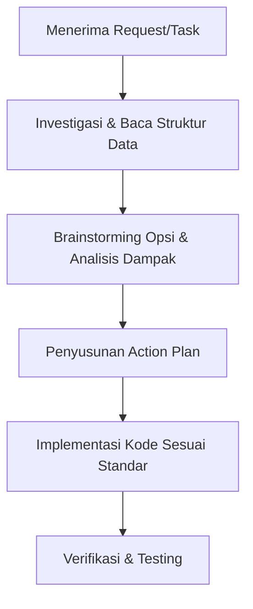

# Agent Guidelines & Development Rules: V-Green SSI Platform

Dokumen aturan dan panduan operasional wajib bagi AI Agent / Developer dalam mengembangkan dan memelihara platform **V-Green SSI**.

---

## 1. Aturan Wajib & Prinsip Utama (Core Directives)

###  1. Selalu Lakukan Brainstorming Sebelum Mengubah Kode
- **Dilarang langsung mengedit/membuat kode tanpa perencanaan.**
- Sebelum melakukan perubahan logika, arsitektur, atau UI:
  1. Identifikasi kebutuhan dan akar permasalahan (*root cause*).
  2. Sajikan opsi solusi beserta analisis trade-off (kelebihan, kekurangan, dan risiko/edge cases).
  3. Susun **Action Plan** yang terstruktur dan terukur.
  4. Diskusikan dan pastikan ada kesepakatan dengan user sebelum eksekusi perubahan besar.

### 🔍 2. Selalu Baca & Pahami Struktur Data yang Ada
- **Wajib menginspeksi struktur data riil sebelum menyentuh logika bisnis atau tampilan.**
- Area struktur data yang wajib diperiksa sebelum modifikasi:
  - **Database & Migrations**: Periksa skema tabel di `database/migrations/` dan seeders di `database/seeders/`.
  - **Models & Relationships**: Periksa definisi relasi Eloquent, fillable, casting, dan accessor di `app/Models/`.
  - **Inertia Props & Types**: Periksa TypeScript interfaces dan type definitions di `resources/js/types/` serta props yang dikirim dari controller ke view.
  - **Dokumentasi Spesifikasi**: Rujuk selalu spesifikasi domain di `docs/PRD.md` dan `docs/TECHNICAL_SPECIFICATION.md`.
- Jangan pernah mengasumsikan nama kolom, foreign key, atau tipe data tanpa melihat file aslinya.

### 🧩 3. Cek Komponen Serupa Sebelum Membuat Baru (Component Reusability & DRY)
- **Dilarang langsung membuat komponen UI/helper baru sebelum memeriksa komponen yang sudah ada.**
- Selalu periksa direktori `resources/js/Components/` (form inputs, buttons, modal, drawers, tables, badges, cards, navigation) sebelum merancang tampilan baru.
- Prinsip pemanfaatan komponen:
  1. **Utamakan Reusability**: Jika komponen dengan fungsi dasar yang sama sudah ada, gunakan kembali komponen tersebut.
  2. **Ekstensi Props / Komposisi**: Jika membutuhkan variasi style atau opsi tambahan, perluas (*extend*) props komponen yang ada secara *backward-compatible* tanpa merusak implementasi sebelumnya.
  3. **Cegah Duplikasi Kode**: Hindari membuat komponen terpisah dengan fungsi serupa hanya karena sedikit perbedaan visual.

### ⚡ 4. Nol Toleransi N+1 Query & Wajib Optimasi Performa Database (Zero N+1 Policy)
- **Dilarang keras membiarkan terjadi N+1 Query di seluruh endpoint dan view.**
- Aturan ketat query & pemrosesan data:
  1. **Eager Loading Wajib**: Jangan pernah mengakses relasi Eloquent (misal: `$station->latestInspection`, `$station->documents`, `$m->facilityType`) di dalam perulangan (`foreach`, `Collection::map`, `filter`) tanpa di-*eager load* sebelumnya menggunakan `->with([...])`.
  2. **Waspadai Model Accessors**: Dilarang mengakses atribut accessor di dalam loop/projection jika accessor tersebut memanggil relasi Eloquent internal (contoh: `$station->document_compliance` yang memanggil `$this->documents`), kecuali relasi pendukungnya sudah dipastikan di-eager load.
  3. **Gunakan `relationLoaded()` Guard**: Pada DTO, Projection, atau Resource, selalu lindungi relasi opsional dengan `$model->relationLoaded('relationName') ? ... : null` agar tidak memicu pemanggilan query tersembunyi (*accidental lazy loading*).
  4. **Prinsip On-Demand / Lazy Loading untuk Data Berat**:
     - Pada dataset masif (seperti 400+ stasiun pada peta GIS atau tabel data), **jangan muat data foto, riwayat log, atau dokumen legalitas di awal**.
     - Muat data awal seringkas mungkin (*lightweight payload*). Sediakan endpoint API on-demand terpisah (contoh: `/stations/{id}/photos`, `/stations/{id}/documents`) yang hanya dipanggil saat drawer atau tab spesifik dibuka oleh pengguna.
  5. **Filter & Agregasi di SQL Level**: Lakukan penyaringan data (seperti `whereHas`, `whereIn`, `selectRaw`) langsung pada database query engine, bukan melalui filtering memori PHP (`$collection->filter()`).
  6. **Verifikasi Query**: Setiap mengubah atau membuat controller/endpoint baru yang memuat data koleksi, pastikan jumlah query tetap konstan $O(1)$ dan tidak bertambah seiring bertambahnya jumlah data $O(N)$.

### 🪟 5. Dropdown & Popover Menu Wajib Escape/Keluar Dari Panel (Anti-Clipping & Zero Container Scrollbar Policy)
- **Dilarang keras membiarkan dropdown menu, action menu (3-dot), atau popover terperangkap di dalam container yang memiliki `overflow-hidden`, `overflow-x-auto`, atau `overflow-y-auto`.**
- Dampak pelanggaran: Menu terpotong (*clipped*), memicu scrollbar vertikal/horizontal semu pada container tabel/card, atau tersembunyi di balik baris tabel lain/footer pagination.
- Standar Wajib Implementasi:
  1. **Wajib Menggunakan React Portal**: Setiap dropdown aksi di dalam tabel atau panel wajib dirender keluar dari hirarki DOM panel ke `document.body` menggunakan komponen `ActionDropdown` (`createPortal`).
  2. **Smart Viewport & Vertical Flipping**: Dropdown wajib mendeteksi batas bawah layar (*viewport bottom*). Jika baris berada di bagian bawah tabel/layar, menu wajib otomatis terbuka ke atas (*flip upwards*) secara presisi.
  3. **Auto-Dismiss Fleksibel**: Menu wajib menutup secara otomatis saat:
     - Pengguna mengklik area di luar menu (*outside click*).
     - Pengguna melakukan *scroll* pada halaman/tabel.
     - Pengguna menekan tombol `Escape`.
     - Pengguna mengklik salah satu item aksi di dalam menu.
  4. **Z-Index Prioritas Tinggi**: Dropdown portal wajib memiliki z-index tinggi (`z-[9999]`) agar tidak tertimpa header tabel *sticky*, modal, drawer, atau floating bar lainnya.

### 🚫 6. Larangan Penggunaan Symlink (Shared Hosting Compatibility & Zero-Symlink Policy)
- **Dilarang keras menggunakan atau mengandalkan symbolic link (`symlink` / `php artisan storage:link`).**
- **Konteks & Alasan**:
  - Aplikasi dirancang dan akan di-deploy ke lingkungan **Shared Hosting** (cPanel / Apache / LiteSpeed) yang tidak mendukung atau menonaktifkan fitur symlink OS/PHP serta tidak memiliki akses terminal root.
- **Aturan Implementasi Upload & Penyimpanan Berkas**:
  1. **Upload Berkas**:
     - Saat menangani fitur upload berkas (dokumen legalitas lahan, foto stasiun, hasil inspeksi, berkas CSV), simpan berkas menggunakan Laravel Storage API (`Storage::disk('public')->put(...)` atau `$file->storeAs(...)`).
     - **Jangan pernah** membuat logika upload, migration, atau seeder yang mengasumsikan berkas dapat diakses melalui tautan fisik `public/storage`.
  2. **Penyajian & Download Berkas (File Serving)**:
     - Seluruh berkas yang diunggah wajib disajikan melalui **Controller Route Streaming** (menggunakan `response()->file($path, ...)` atau `response()->download(...)`), bukan melalui akses langsung web server ke direktori statis symlink.
     - Pertahankan rute bridge symlink-free di Laravel (`/storage/{path}` -> `StationController@serveStorageFile`) untuk menangani URL path publik secara transparan tanpa symlink fisik.
  3. **Konfigurasi Filesystem**:
     - Pada `config/filesystems.php`, pastikan `'serve' => false` pada disk `local` agar tidak menimpa route file streaming dan tidak memicu error 403 Forbidden bawaan Laravel 11.
  4. **Larangan Eksekusi Perintah Symlink**:
     - Dilarang membuat script deployment, migration, seeder, atau helper yang mengeksekusi `Artisan::call('storage:link')` atau fungsi `symlink()`.

---

## 2. Alur Kerja Standar (Workflow Protocol)

Setiap menangani tiket/task/perubahan, ikuti tahapan berikut secara disiplin:

1. **Phase 1 — Data, Components & Codebase Investigation**:
   - Baca file schema, controller, request validator, model, dan komponen frontend terkait.
   - Periksa ketersediaan komponen di `resources/js/Components/` untuk memastikan tidak ada duplikasi komponen baru.
   - Pahami alur data dari database -> backend (Laravel) -> bridge (Inertia.js) -> UI (React/TypeScript).

2. **Phase 2 — Brainstorming & Solution Design**:
   - Rumuskan solusi teknis yang mematuhi arsitektur bersih (*Clean Architecture / DDD*).
   - Pertimbangkan performa, skalabilitas (misal: query N+1, payload size Inertia, render cycle React).

3. **Phase 3 — Action Plan**:
   - Tuliskan langkah spesifik file mana yang akan diubah/dibuat.
   - Tetapkan urutan eksekusi yang logis (contoh: Migration -> Model -> Controller/Action -> Frontend View).

4. **Phase 4 — Execution & Verification**:
   - Terapkan perubahan dengan kode yang bersih, terdokumentasi, dan minim efek samping (*no breaking changes*).
   - Verifikasi fungsionalitas dan konsistensi tipe data.

---

## 3. Standar Frontend & UI/UX

- Ikuti selalu aturan **Frontend Design System** yang terdokumentasi di [`.agents/skills/fe-design-system/SKILL.md`](.agents/skills/fe-design-system/SKILL.md) dan [`docs/SKILL.md`](docs/SKILL.md):
  - **Anti-AI Slop**: Hindari layout sempit, gradien liar, dan kontras menyilaukan.
  - **Breathing Room**: Terapkan spasi lega (`p-6` hingga `p-8` pada container, `p-6` pada card).
  - **Sinao Ergonomic Palette**: Gunakan kanvas sejuk (`#F7F9FC`), teks kontras tinggi (`slate-900`/`slate-600`), dan warna aksen terarah.
  - **Typography**: Gunakan font *Plus Jakarta Sans* dengan hierarki bobot yang terstruktur.
  - **Dropdown & Action Menu Keluar Dari Panel**: Selalu gunakan komponen portal (`ActionDropdown`) untuk menu aksi di dalam tabel/panel agar tidak memicu scrollbar container atau terpotong tepi panel.
