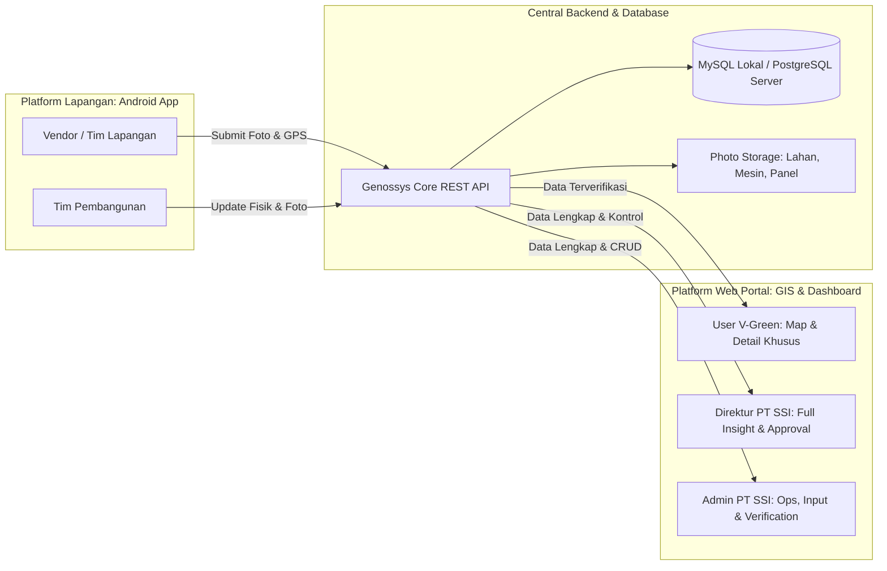

# Product Requirements Document (PRD)
## V-Green & PT SSI - Charging Station Tracking & Field Operations Platform

| Metadata | Detail |
| :--- | :--- |
| **Project Name** | V-Green SSI Charging Station Management & GIS Platform |
| **Version** | 1.6 (Finalized Tech Stack: Laravel + Inertia React + Google Maps) |
| **Status** | Approved & Ready for Kickoff |
| **Project Management & Tech Lead** | **Genossys** |
| **Client & Stakeholders** | **PT SSI** (Operations & Survey Partner) & **V-Green** (Principal EV Charging Network) |
| **Architecture** | **Domain-Driven Design (DDD) & Clean Architecture** |
| **Backend & Web Framework** | **Laravel 12 + Inertia.js (React) + Tailwind CSS** |
| **Database** | **MySQL (Lokal) / PostgreSQL (Server Production)** |
| **Map Engine** | **Google Maps JavaScript API** |
| **Mobile Target** | **Flutter (Android - Phase 2)** |

---

## 1. Arsitektur Ekosistem & Pemisahan Platform

Sistem terdiri dari dua platform terintegrasi:



---

## 2. Strategi Database (Tanpa Native ENUM)

Untuk menjamin kompatibilitas penuh antara MySQL lokal dan PostgreSQL di server tanpa migrasi rumit, sistem **tidak menggunakan native database ENUM**, melainkan:
1. **Master Lookup / Reference Tables** (`m_facility_types`, `m_station_statuses`, `m_checklist_slots`, `m_approval_statuses`, `m_roles`).
2. **TypeScript String Literal Unions** di layer frontend/domain untuk *strict type safety*.

---

## 3. Klasifikasi Tipe Stasiun & Visualisasi Peta

1. 🚗 **EVCS (Electric Vehicle Charging Station):** Stasiun pengisian daya khusus **mobil listrik** (Charger AC/DC Fast Charging).
2. 🛵 **BSS (Battery Swapping Station):** Stasiun penukaran baterai khusus **motor listrik**.
3. ⚡ **Kombinasi (EVCS + BSS):** Lokasi terpadu yang melayani mobil sekaligus motor.

### Skema Pembeda Visual pada Peta (Icon & Color Scheme)
- **Ikon Marker:**
  - Ikon Mobil Listrik untuk `EVCS`.
  - Ikon Baterai/Swap untuk `BSS`.
  - Ikon Dual/Hub untuk `COMBINED`.
- **Warna Marker (Berdasarkan Status Kesiapan):**
  - 🟢 **Hijau (OPERATIONAL / Ready):** Titik aktif / serah terima ke V-Green selesai.
  - 🟠 **Oranye (CONSTRUCTION):** Titik dalam proses konstruksi fisik/elektrikal.
  - 🟡 **Kuning (SURVEYED / PLANNED):** Lokasi rencana/survei kelayakan lahan.
  - 🔴 **Merah (ON_HOLD):** Titik yang mengalami kendala teknis/perizinan.

---

## 4. Matriks Peran Pengguna & Diferensiasi Tampilan (Role Projections)

| Role | Platform Akses | Tampilan & Wewenang Utama |
| :--- | :--- | :--- |
| **V-Green (Client)** | Web Portal | • Peta Indonesia interaktif (EVCS / BSS / Kombinasi).<br>• Drawer Detail Khusus V-Green: spesifikasi teknis, status kesiapan, foto resmi terverifikasi.<br>• *Tanpa akses ke data operasional internal PT SSI.* |
| **Direktur PT SSI** | Web Portal | • Executive Overview: metrik progres nasional, sebaran titik, dan statistik kesiapan.<br>• Data detail lengkap: identitas surveyor/kontraktor, riwayat kendala, dan log approval.<br>• Wewenang verifikasi & approval tingkat pimpinan. |
| **Admin PT SSI** | Web Portal | • Manajemen Master Data: CRUD stasiun, impor data sebaran.<br>• Verifikasi teknis laporan lapangan & checklist foto 7 sudut.<br>• Penugasan vendor survei/pembangunan. |
| **Vendor Lapangan & Tim Pembangunan** | Android App *(Fase 2)* | • Form penugasan mobile.<br>• Kamera checklist 7 sudut foto (Lahan, Mesin, Panel) dengan validasi GPS otomatis. |

---

## 5. Standarisasi 7 Sudut Foto Lapangan (Inspection Checklist)

Setiap titik stasiun wajib memiliki 7 sudut foto terverifikasi:
1. **Area Lahan (Ground):** Tampak Depan, Tampak Samping, Akses Masuk Kendaraan.
2. **Mesin Charger (Charger Unit):** Tampak Depan, Tampak Belakang.
3. **Panel & Tiang Listrik:** Tampak Depan, Tampak Belakang.

---

## 6. Struktur Database Master & Relasional

```sql
m_facility_types   (id VARCHAR(30) PK, name, icon_name, description)
m_station_statuses (id VARCHAR(30) PK, name, color_code, step_order)
m_checklist_slots  (id VARCHAR(50) PK, category, label, angle, is_required)
m_approval_statuses(id VARCHAR(30) PK, name)
m_roles            (id VARCHAR(30) PK, name, description)

users              (id, name, email, password, role_id FK, created_at, updated_at)
stations           (id, code, name, facility_type_id FK, status_id FK, latitude, longitude, address, city, province, power_capacity_kw, socket_types, operational_hours, created_at, updated_at)
inspection_reports (id, station_id FK, user_id FK, approval_status_id FK, reviewer_id FK, notes, submitted_at, reviewed_at)
inspection_photos  (id, report_id FK, checklist_slot_id FK, file_path, latitude, longitude, taken_at, status)
```
