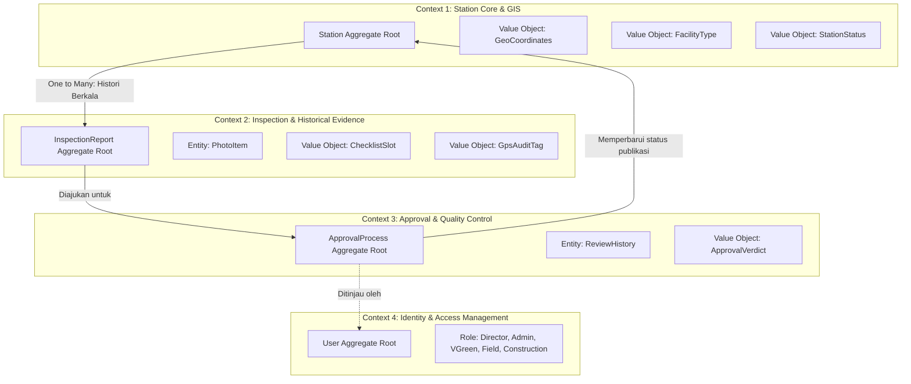
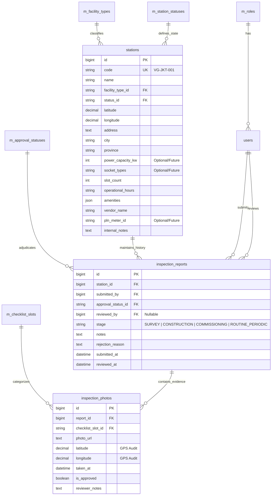
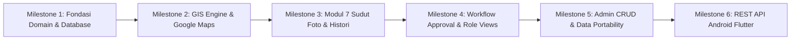

# Master Technical Specification & Engineering Roadmap
## V-Green SSI Charging Station Management & GIS Platform

| Metadata | Keterangan |
| :--- | :--- |
| **Project Lead & PM** | **Genossys** |
| **Stakeholders** | **PT SSI** (Operations & Survey Partner) & **V-Green** (Principal Network) |
| **Dokumen Target** | Developer Implementation Blueprint & Sprint Milestones |
| **Arsitektur Utama** | **Domain-Driven Design (DDD)** |
| **Tech Stack** | **Laravel 12 + Inertia.js (React) + Tailwind CSS + Google Maps API** |
| **Database** | **MySQL (Lokal) / PostgreSQL (Server Production)** |

---

## 1. Domain Architecture (Domain-Driven Design)

### 1.1 Ubiquitous Language (Glosarium Baku)
Setiap pengembang wajib menggunakan istilah baku berikut pada kode, penamaan tabel, class, dan method:
- **`Station` (Site):** Entitas stasiun fisik pengisian daya listrik.
- **`FacilityType`:** Jenis layanan (`EVCS` = Mobil Listrik, `BSS` = Motor Listrik, `COMBINED` = Keduanya).
- **`InspectionReport`:** Sesi audit lapangan berkala (survei awal, progres pembangunan, uji fungsi komisioning, atau inspeksi berkala per 4 bulan).
- **`ChecklistSlot`:** 7 sudut pandang foto wajib terstandarisasi.
- **`ApprovalVerdict`:** Keputusan verifikasi oleh PT SSI (`PENDING_REVIEW`, `APPROVED`, `REVISION_REQUIRED`).
- **`Handover`:** Serah terima resmi titik yang telah disetujui untuk dipublikasikan ke sisi V-Green.

---

### 1.2 Bounded Contexts & Tanggung Jawab

---

### 1.3 Aturan Domain Kritis (Domain Invariants & Business Rules)

1. **Histori Inspeksi Berkala (Non-Destructive Audit Trail):**
   - Relasi antara `Station` dan `InspectionReport` adalah **One-to-Many**.
   - Data laporan lama **tidak boleh ditimpa (no overwrite)** saat ada inspeksi baru.
   - Jenis inspeksi (`stage`) terbagi menjadi:
     - `INITIAL_SURVEY` (Survei kelayakan awal lahan).
     - `CONSTRUCTION_PROGRESS` (Progres fisik berkala pembangunan).
     - `COMMISSIONING` (Uji serah terima akhir sebelum go-live).
     - `ROUTINE_PERIODIC` (Inspeksi rutin berkala tiap 4 bulan untuk pemeliharaan).
2. **Kesiapan Atribut Masa Depan (Future-Proofing Attributes):**
   - Atribut teknis seperti `power_capacity_kw`, `socket_types`, `cabinet_count`, dan `pln_meter_id` **tetap disediakan di skema database (nullable)**.
   - Pada MVP tahap pertama, field ini bersifat opsional sehingga tim developer tidak terhambat jika data teknis tersebut belum lengkap dari lapangan.
3. **Gerbang Serah Terima (Handover Gate to V-Green):**
   - Data stasiun hanya tampil di sisi **V-Green** jika laporan inspeksi terakhir berstatus **`APPROVED`** dan stasiun berstatus **`OPERATIONAL`**.
   - Jika laporan berada di status `REVISION_REQUIRED` atau `PENDING_REVIEW`, data operasional dan foto mentah hanya dapat diakses oleh **Direktur & Admin PT SSI**.

---

## 2. Skema Relasional Database (Database-Agnostic)

---

## 3. Matriks Hak Akses & Proyeksi Tampilan (RBAC Matrix)

| Atribut / Aksi Data | Direktur PT SSI | Admin PT SSI | V-Green (Klien) | Vendor Lapangan | Tim Pembangunan |
| :--- | :---: | :---: | :---: | :---: | :---: |
| **Akses Peta Nasional** | Full (Semua Titik) | Full (Semua Titik) | Hanya `OPERATIONAL` / Approved | Titik Ditugaskan | Titik Ditugaskan |
| **Detail Teknis Resmi** | Read / Write | Read / Write | Read-Only | Read-Only | Read-Only |
| **Histori Laporan Berkala** | Full Read | Full Read / Manage | Terverifikasi Terakhir | Draft Sendiri | Draft Sendiri |
| **Checklist 7 Sudut Foto** | Full Read | Full Read | Foto Resmi Terakhir | Upload / Edit Draft | Upload / Edit Draft |
| **Aksi Approval / Revisi** | Approve / Reject | Approve / Reject | Tidak Ada Akses | Tidak Ada Akses | Tidak Ada Akses |
| **Catatan Internal & Vendor** | Visible | Visible | **Hidden** | **Hidden** | **Hidden** |
| **Manajemen Akun & CRUD** | Full Super Admin | Operational CRUD | Tidak Ada Akses | Tidak Ada Akses | Tidak Ada Akses |

---

## 4. Engineering Milestones (Panduan Pengerjaan Developer)

---

### 🟢 Milestone 1: Fondasi Domain & Database (Selesai / Baseline)
- **Tujuan:** Menyiapkan struktur proyek, standardisasi coding, skema database, dan mock data.
- **Deliverables:**
  - Setup repository Laravel 12 + Inertia React + Tailwind CSS v4.
  - Implementasi tabel master lookup (`m_roles`, `m_facility_types`, `m_station_statuses`, `m_checklist_slots`, `m_approval_statuses`).
  - Database seeder 15 titik stasiun uji coba se-Indonesia dengan 7 sudut foto.
  - Test suite dasar (25 unit/feature tests passing 100%).
- **Definition of Done (DoD):** `php artisan test` hijau 100%, server berjalan tanpa runtime error.

---

### 🟡 Milestone 2: GIS Interactive Engine & Google Maps Integration
- **Tujuan:** Visualisasi spasial tingkat tinggi dengan performa optimal.
- **Tugas Developer:**
  1. Integrasi Google Maps JavaScript API via `@googlemaps/js-api-loader`.
  2. Implementasi Marker Pin adaptif (Custom SVG/Canvas) yang membedakan ikon mobil (`EVCS`), motor (`BSS`), dan dual hub (`COMBINED`).
  3. Warna marker reaktif sesuai status: 🟢 Operasional, 🟠 Pembangunan, 🟡 Survei, 🔴 On-Hold.
  4. Penyediaan fallback Interactive GIS Canvas jika API key Google Maps belum terpasang di `.env`.
  5. Fitur Marker Clustering untuk performa saat zoom-out skala kepulauan Indonesia.
- **Acceptance Criteria:**
  - Klik marker pada peta langsung membuka Drawer Detail stasiun secara instan (<200ms) tanpa reload halaman.
  - Filter pencarian (kota/nama/tipe) memperbarui titik di peta secara reaktif.

---

### 🟡 Milestone 3: Modul 7 Sudut Foto & Histori Inspeksi Berkala
- **Tujuan:** Pengelolaan dokumentasi visual fisik stasiun dengan rekam jejak historis yang tidak menimpa data lama.
- **Tugas Developer:**
  1. Implementasi form upload checklist 7 sudut foto:
     - **Lahan:** Depan, Samping, Akses Masuk.
     - **Mesin:** Depan, Belakang.
     - **Panel & Tiang:** Depan, Belakang.
  2. Kompresi gambar otomatis di sisi klien (maksimal 1.5MB per foto) sebelum upload.
  3. Perekaman metadata audit tag: GPS Latitude/Longitude perangkat dan timestamp saat pengambilan gambar.
  4. Komponen **Linimasa Riwayat Inspeksi (Inspection Timeline)** pada detail stasiun untuk melihat rekam jejak survei, konstruksi, dan inspeksi berkala per 4 bulan.
  5. Photo Modal Viewer dengan fitur zoom, navigasi antar sudut, dan penampil tag GPS.
- **Acceptance Criteria:**
  - Pengguna dapat melihat galeri foto per sesi inspeksi (riwayat tidak hilang).
  - Setiap foto memiliki label sudut dan status persetujuan yang jelas.

---

### 🟡 Milestone 4: Approval Workflow & Diferensiasi Tampilan (Role Views)
- **Tujuan:** Memisahkan data publikasi klien (V-Green) dengan data operasional internal (PT SSI) serta gerbang persetujuan 2 arah.
- **Tugas Developer:**
  1. Implementasi *Projection Layer* di Controller (`StationController`):
     - View V-Green hanya mengembalikan stasiun terverifikasi dan foto yang berstatus `is_approved = true`.
     - View Direktur & Admin mengembalikan seluruh metadata internal (vendor, PLN meter, catatan lapangan).
  2. Panel Aksi Approval untuk Direktur & Admin PT SSI:
     - Tombol **Setujui Titik (Approve & Publish)**: Mengubah status laporan menjadi `APPROVED` dan mempublikasikan stasiun.
     - Tombol **Minta Revisi (Reject & Request Revision)**: Mengubah status menjadi `REVISION_REQUIRED`, membuka modal catatan perbaikan teknis.
  3. Audit log siapa yang menyetujui/menolak beserta waktu verifikasi.
- **Acceptance Criteria:**
  - Perwakilan V-Green tidak dapat melihat stasiun yang berstatus draft atau catatan penolakan internal.
  - Setiap perubahan status tercatat di tabel audit histori.

---

### 🟡 Milestone 5: Station Management & Data Portability (Admin Panel)
- **Tujuan:** Mempermudah Admin PT SSI dalam menambah, mengubah, dan memindahkan titik stasiun secara massal.
- **Tugas Developer:**
  1. Form Tambah & Edit Stasiun dengan **Interactive Pin Coordinate Picker** (drag & drop pin di peta untuk menentukan Latitude/Longitude).
  2. Modul **Import Data Massal**: Upload file Excel/Spreadsheet (`.xlsx`, `.csv`) untuk pendaftaran puluhan titik stasiun sekaligus.
  3. Modul **Export Data**: Unduh rekapitulasi data stasiun dan status operasional ke format Excel dan PDF summary.
- **Acceptance Criteria:**
  - Admin dapat mendaftarkan titik baru dalam waktu kurang dari 2 menit.
  - File Excel yang di-upload tervalidasi dengan pesan error baris demi baris jika ada koordinat yang tidak valid.

---

### 🟡 Milestone 6: REST API Backend Terstandarisasi (Kesiapan Mobile Flutter)
- **Tujuan:** Menyediakan layanan backend bagi aplikasi Android tim lapangan di Fase 2.
- **Tugas Developer:**
  1. Konfigurasi **Laravel Sanctum** untuk penerbitan token autentikasi API.
  2. Pembuatan endpoint terstruktur pada `routes/api.php`:
     - `POST /api/v1/auth/login`: Autentikasi surveyor/kontraktor lapangan.
     - `GET /api/v1/assignments`: Mengambil daftar stasiun yang ditugaskan kepada vendor terkait.
     - `POST /api/v1/stations/{station}/inspections`: Mengirim data survei dan upload 7 sudut foto langsung dari kamera HP.
     - `GET /api/v1/inspections/{report}/status`: Mengecek status apakah laporan di-approve atau butuh revisi.
  3. Dokumentasi kontrak API (Swagger / Postman Collection).
- **Acceptance Criteria:**
  - Respons API konsisten menggunakan format standar JSON: `{ success: true, data: {...}, message: "..." }`.
  - Endpoint upload mendukung multipart/form-data dengan validasi ukuran dan format file foto.

---

## 5. Standar Kualitas & Definition of Done (DoD)

Setiap fitur yang diselesaikan oleh tim developer wajib memenuhi kriteria:
1. **Clean Code & DDD Layering:** Logika bisnis tidak ditulis di Blade/React Component atau Controller gemuk, melainkan di Services/Actions.
2. **Automated Testing:** Setiap endpoint baru atau alur transisi status wajib disertai unit/feature test.
3. **Database Migration Safety:** Tidak ada perubahan skema yang merusak data eksisting (`down()` method harus selalu teruji).
4. **Git Workflow:** Menggunakan fitur branch (`feature/nama-fitur`), Pull Request (PR), dan wajib lolos review arsitektur sebelum merge ke `master`.
