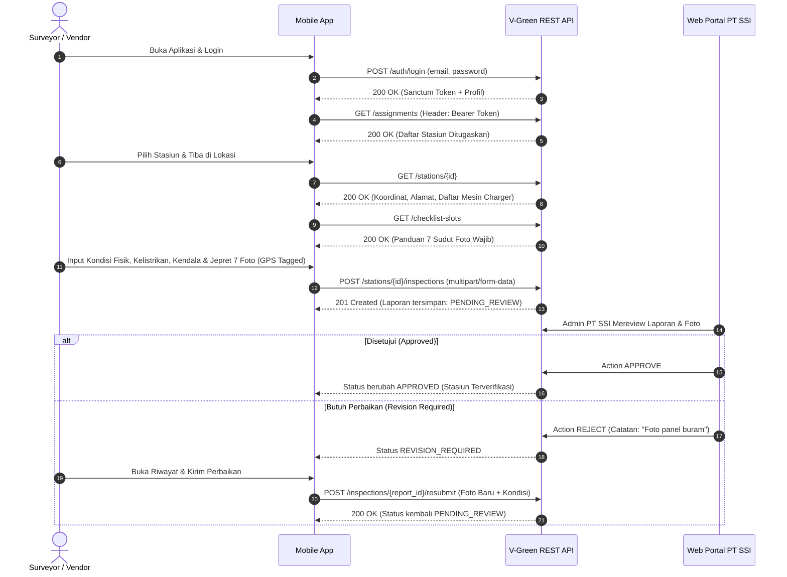

# Dokumentasi REST API Vendor Lapangan (V-Green SSI)
## Modul Pelaporan Kondisi Fisik & Dokumentasi Foto 7 Sudut Lapangan

Dokumentasi resmi integrasi REST API bagi **Vendor Lapangan (Field Surveyor)** dan **Tim Pembangunan (Contractor)** untuk aplikasi mobile (Android/Flutter/React Native) dan integrasi sistem eksternal pada platform **V-Green SSI**.

---

## 📌 Daftar Isi
1. [Arsitektur & Konvensi Umum](#1-arsitektur--konvensi-umum)
2. [Alur Kerja Vendor (End-to-End Workflow)](#2-alur-kerja-vendor-end-to-end-workflow)
3. [Daftar Endpoint API](#3-daftar-endpoint-api)
   - [A. Autentikasi & Akun](#a-autentikasi--akun)
   - [B. Titik Penugasan & Master Data](#b-titik-penugasan--master-data)
   - [C. Pelaporan Kondisi & Foto Lapangan](#c-pelaporan-kondisi--foto-lapangan)
   - [D. Riwayat & Alur Revisi Laporan](#d-riwayat--alur-revisi-laporan)
4. [Kamus Data & Status (Enums / Master Reference)](#4-kamus-data--status-enums--master-reference)
5. [Contoh Kasus & Panduan cURL / Postman](#5-contoh-kasus--panduan-curl--postman)
6. [Penanganan Error & HTTP Status Code](#6-penanganan-error--http-status-code)

---

## 1. Arsitektur & Konvensi Umum

- **Base URL:**
  - Lokal Development: `http://127.0.0.1:8000/api/v1`
  - Staging / Production: `https://vgreen.ssi.co.id/api/v1`
- **Format Data:** `application/json` (Kecuali endpoint upload file menggunakan `multipart/form-data`).
- **Skema Autentikasi:** **Bearer Token (Laravel Sanctum)** pada HTTP Header `Authorization`.
- **Standar Format Respons:**
  ```json
  {
    "success": true,
    "message": "Pesan deskriptif operasi.",
    "data": { ... }
  }
  ```
- **Audit GPS & Geofencing:**
  - Setiap foto dan laporan menyertakan koordinat `latitude` dan `longitude` perangkat.
  - Backend otomatis menghitung `distance_meters` (jarak foto/laporan terhadap titik resmi stasiun menggunakan formula *Haversine*) untuk audit integritas data di lapangan.
- **Penyimpanan Berkas (Zero-Symlink Policy):** Seluruh file foto disajikan via streaming route bridge `/storage/{path}` yang aman dan kompatibel dengan semua jenis hosting.

---

## 2. Alur Kerja Vendor (End-to-End Workflow)



---

## 3. Daftar Endpoint API

### A. Autentikasi & Akun

#### 1. Login Surveyor / Vendor
Mendapatkan Sanctum Bearer Token untuk akses endpoint protected.
- **Method:** `POST`
- **Endpoint:** `/auth/login`
- **Headers:** `Accept: application/json`, `Content-Type: application/json`
- **Request Body:**
  | Field | Tipe | Wajib | Keterangan |
  | :--- | :--- | :--- | :--- |
  | `email` | `string` | Ya | Email akun vendor yang terdaftar di PT SSI. |
  | `password` | `string` | Ya | Kata sandi akun. |
  | `device_name` | `string` | Tidak | Nama perangkat (misal: `"Samsung Tab S8 Lapangan"`). |

- **Contoh Request Body:**
  ```json
  {
    "email": "vendor@mitra.co.id",
    "password": "password123",
    "device_name": "Samsung Galaxy Tab A8 Lapangan"
  }
  ```

- **Contoh Respons (200 OK):**
  ```json
  {
    "success": true,
    "message": "Autentikasi surveyor lapangan berhasil.",
    "data": {
      "token": "1|nO3v5qJv82kZ...sanctum_token...",
      "token_type": "Bearer",
      "user": {
        "id": 4,
        "name": "Ahmad Fauzi (Surveyor Lapangan)",
        "email": "vendor@mitra.co.id",
        "role_id": "FIELD_VENDOR",
        "role_name": "Vendor Lapangan",
        "organization": "PT Mitra Elektrik Nusantara",
        "phone_number": "+628567891011"
      }
    }
  }
  ```

---

#### 2. Profil Akun Aktif
Mengecek identitas akun vendor yang sedang login.
- **Method:** `GET`
- **Endpoint:** `/auth/me`
- **Headers:** `Authorization: Bearer <token>`, `Accept: application/json`
- **Contoh Respons (200 OK):**
  ```json
  {
    "success": true,
    "message": "Data profil surveyor berhasil diambil.",
    "data": {
      "user": {
        "id": 4,
        "name": "Ahmad Fauzi (Surveyor Lapangan)",
        "email": "vendor@mitra.co.id",
        "role_id": "FIELD_VENDOR",
        "role_name": "Vendor Lapangan",
        "organization": "PT Mitra Elektrik Nusantara",
        "phone_number": "+628567891011"
      }
    }
  }
  ```

---

#### 3. Logout
Menghapus access token yang sedang aktif.
- **Method:** `POST`
- **Endpoint:** `/auth/logout`
- **Headers:** `Authorization: Bearer <token>`, `Accept: application/json`
- **Contoh Respons (200 OK):**
  ```json
  {
    "success": true,
    "message": "Sesi mobile berhasil diakhiri.",
    "data": null
  }
  ```

---

### B. Titik Penugasan & Master Data

#### 4. Referensi 7 Sudut Foto Standar
Mengambil daftar slot checklist 7 sudut foto wajib untuk UI kamera mobile app.
- **Method:** `GET`
- **Endpoint:** `/checklist-slots`
- **Headers:** `Accept: application/json`
- **Contoh Respons (200 OK):**
  ```json
  {
    "success": true,
    "message": "Daftar 7 sudut foto terstandarisasi berhasil diambil.",
    "data": {
      "slots": [
        {
          "id": "LAHAN_DEPAN",
          "category": "LAHAN",
          "label": "Lahan - Tampak Depan",
          "angle": "Depan",
          "is_required": true
        },
        {
          "id": "LAHAN_SAMPING",
          "category": "LAHAN",
          "label": "Lahan - Tampak Samping",
          "angle": "Samping",
          "is_required": true
        },
        {
          "id": "LAHAN_AKSES",
          "category": "LAHAN",
          "label": "Lahan - Akses Masuk Kendaraan",
          "angle": "Akses Masuk",
          "is_required": true
        },
        {
          "id": "MESIN_DEPAN",
          "category": "MESIN",
          "label": "Mesin Charger - Tampak Depan",
          "angle": "Depan",
          "is_required": true
        },
        {
          "id": "MESIN_BELAKANG",
          "category": "MESIN",
          "label": "Mesin Charger - Tampak Belakang",
          "angle": "Belakang",
          "is_required": true
        },
        {
          "id": "PANEL_DEPAN",
          "category": "PANEL_TIANG",
          "label": "Panel & Tiang - Tampak Depan",
          "angle": "Depan",
          "is_required": true
        },
        {
          "id": "PANEL_BELAKANG",
          "category": "PANEL_TIANG",
          "label": "Panel & Tiang - Tampak Belakang",
          "angle": "Belakang",
          "is_required": true
        }
      ]
    }
  }
  ```

---

#### 5. Daftar Penugasan Stasiun (Assignments)
Mengambil seluruh titik stasiun yang ditugaskan kepada vendor/organisasi yang sedang login.
- **Method:** `GET`
- **Endpoint:** `/assignments`
- **Headers:** `Authorization: Bearer <token>`, `Accept: application/json`
- **Contoh Respons (200 OK):**
  ```json
  {
    "success": true,
    "message": "Daftar penugasan stasiun berhasil diambil.",
    "data": {
      "total": 1,
      "assignments": [
        {
          "id": 1,
          "code": "VG-JKT-001",
          "name": "SPKLU V-Green Plaza Senayan",
          "facility_type": {
            "id": "EVCS",
            "name": "EVCS (Mobil Listrik)"
          },
          "status": {
            "id": "CONSTRUCTION",
            "name": "Tahap Konstruksi"
          },
          "coordinates": {
            "latitude": -6.2255,
            "longitude": 106.8095
          },
          "address": "Jl. Asia Afrika No.8, Gelora, Tanah Abang",
          "city": "Jakarta Pusat",
          "province": "DKI Jakarta",
          "power_capacity_kw": 120,
          "socket_types": "CCS2 Dual Gun 120kW",
          "slot_count": 2,
          "operational_hours": "24 Jam",
          "vendor_name": "PT Mitra Elektrik Nusantara",
          "latest_inspection_status": "PENDING_REVIEW"
        }
      ]
    }
  }
  ```

---

#### 6. Detail Lengkap Titik Stasiun
Mengambil data detail stasiun, PIC pengelola lahan, serta daftar unit mesin charger (`station_machines`) sebelum surveyor memulai inspeksi.
- **Method:** `GET`
- **Endpoint:** `/stations/{station_id}`
- **Headers:** `Authorization: Bearer <token>`, `Accept: application/json`
- **Contoh Respons (200 OK):**
  ```json
  {
    "success": true,
    "message": "Detail stasiun berhasil diambil.",
    "data": {
      "station": {
        "id": 1,
        "code": "VG-JKT-001",
        "name": "SPKLU V-Green Plaza Senayan",
        "facility_type": {
          "id": "EVCS",
          "name": "EVCS (Mobil Listrik)"
        },
        "status": {
          "id": "CONSTRUCTION",
          "name": "Tahap Konstruksi",
          "color_code": "#F59E0B"
        },
        "coordinates": {
          "latitude": -6.2255,
          "longitude": 106.8095
        },
        "address": "Jl. Asia Afrika No.8, Gelora, Tanah Abang",
        "city": "Jakarta Pusat",
        "province": "DKI Jakarta",
        "postal_code": "10270",
        "power_capacity_kw": 120,
        "socket_types": "CCS2 Dual Gun 120kW",
        "slot_count": 2,
        "operational_hours": "24 Jam",
        "vendor_name": "PT Mitra Elektrik Nusantara",
        "landlord_name": "Pengelola Gedung Plaza Senayan",
        "landlord_phone": "+6281122334455",
        "latest_inspection": {
          "id": 12,
          "stage": "CONSTRUCTION_PROGRESS",
          "approval_status": "REVISION_REQUIRED",
          "submitted_at": "2026-11-15T14:30:00+07:00",
          "rejection_reason": "Foto panel buram dan grounding belum terukur."
        },
        "machines": [
          {
            "id": 101,
            "name": "DC Fast Charger Unit 01",
            "brand": "Autel",
            "model_series": "MaxiCharger DC 120kW",
            "serial_number": "AT-2026-SN-8821",
            "power_capacity_kw": 120,
            "socket_types": "CCS2 Dual Gun",
            "slot_or_gun_count": 2,
            "status": "OPERATIONAL"
          }
        ]
      }
    }
  }
  ```

---

### C. Pelaporan Kondisi & Foto Lapangan

#### 7. Submit Laporan Inspeksi (Foto 7 Sudut + Pelaporan Kondisi Fisik)
Endpoint utama vendor untuk mengirimkan seluruh bukti dokumentasi foto dan penilaian kondisi lapangan.
- **Method:** `POST`
- **Endpoint:** `/stations/{station_id}/inspections`
- **Headers:** `Authorization: Bearer <token>`, `Content-Type: multipart/form-data`, `Accept: application/json`

##### Parameter Form Data (Multipart):
| Parameter | Tipe | Wajib | Keterangan |
| :--- | :--- | :--- | :--- |
| **`stage`** | `string` | **Ya** | Tahapan inspeksi: `INITIAL_SURVEY`, `CONSTRUCTION_PROGRESS`, `COMMISSIONING`, `ROUTINE_PERIODIC`. |
| **`overall_condition`** | `string` | Tidak | Status kondisi fisik umum: `BAIK`, `CUKUP`, `RUSAK_RINGAN`, `RUSAK_BERAT` (Default: `BAIK`). |
| **`physical_condition`** | `string` | Tidak | Deskripsi kondisi lahan, kebersihan, kanopi, dan marka jalan. |
| **`electrical_condition`** | `string` | Tidak | Deskripsi kelistrikan, tegangan (380V/220V), meteran PLN, MCB, grounding. |
| **`issues_found[]`** | `array of string` | Tidak | Daftar temuan kendala (bisa dikirim berulang: `issues_found[]`). |
| **`machine_conditions`** | `array of object` | Tidak | Status kondisi tiap unit mesin charger: `[{ "machine_id": 101, "status": "OPERATIONAL", "notes": "..." }]`. |
| **`latitude`** | `numeric` | Tidak | Titik latitude perangkat saat tombol kirim ditekan (-12.0 s/d 7.0). |
| **`longitude`** | `numeric` | Tidak | Titik longitude perangkat saat tombol kirim ditekan (94.0 s/d 142.0). |
| **`notes`** | `string` | Tidak | Catatan umum vendor lapangan (maksimal 2000 karakter). |
| **`photo_<SLOT_ID>`** | `file binary` | Rekomendasi | File gambar JPG/PNG (misal: `photo_LAHAN_DEPAN`, `photo_MESIN_DEPAN`, dll). Maks 5MB per foto. |
| **`lat_<SLOT_ID>`** | `numeric` | Rekomendasi | Latitude GPS saat foto jepretan slot tersebut diambil. |
| **`lng_<SLOT_ID>`** | `numeric` | Rekomendasi | Longitude GPS saat foto jepretan slot tersebut diambil. |
| **`taken_at_<SLOT_ID>`**| `date/time` | Tidak | Waktu pengambilan foto (format: `YYYY-MM-DD HH:mm:ss`). |

> **💡 Opsi Alternatif Pengiriman Foto:** Selain menggunakan format `photo_<SLOT_ID>`, vendor juga bisa mengirim dalam format array `photos[0][slot_id]`, `photos[0][file]`, `photos[0][latitude]`, `photos[0][longitude]`, `photos[0][taken_at]`.

##### Contoh Respons Berhasil (201 Created):
```json
{
  "success": true,
  "message": "Laporan inspeksi & dokumentasi kondisi lapangan berhasil diunggah.",
  "data": {
    "report_id": 18,
    "station_code": "VG-JKT-001",
    "stage": "CONSTRUCTION_PROGRESS",
    "overall_condition": "BAIK",
    "distance_meters": 11.45,
    "approval_status": "PENDING_REVIEW",
    "submitted_at": "2026-11-19T09:55:00+07:00",
    "photos_count": 7
  }
}
```

---

### D. Riwayat & Alur Revisi Laporan

#### 8. Riwayat Laporan Inspeksi Vendor
Mengambil daftar histori laporan yang pernah diajukan oleh akun vendor terkait.
- **Method:** `GET`
- **Endpoint:** `/inspections`
- **Headers:** `Authorization: Bearer <token>`, `Accept: application/json`
- **Query Parameters (Filter Opsional):**
  - `status`: Filter status approval (`PENDING_REVIEW`, `REVISION_REQUIRED`, `APPROVED`).
  - `stage`: Filter tahapan inspeksi.
  - `station_id`: Filter titik stasiun tertentu.

- **Contoh Request:** `GET /api/v1/inspections?status=REVISION_REQUIRED`
- **Contoh Respons (200 OK):**
  ```json
  {
    "success": true,
    "message": "Riwayat laporan inspeksi berhasil diambil.",
    "data": {
      "total": 1,
      "reports": [
        {
          "id": 18,
          "station": {
            "id": 1,
            "code": "VG-JKT-001",
            "name": "SPKLU V-Green Plaza Senayan",
            "city": "Jakarta Pusat",
            "province": "DKI Jakarta"
          },
          "stage": "CONSTRUCTION_PROGRESS",
          "overall_condition": "RUSAK_RINGAN",
          "approval_status": {
            "id": "REVISION_REQUIRED",
            "name": "Perlu Revisi"
          },
          "photos_count": 7,
          "distance_meters": 11.45,
          "submitted_at": "2026-11-19T09:55:00+07:00",
          "reviewed_at": "2026-11-19T10:15:00+07:00",
          "rejection_reason": "Sudut kabel panel belum rapi, grounding belum terpasang."
        }
      ]
    }
  }
  ```

---

#### 9. Detail Lengkap & Status Laporan Sesi Tertentu
Mengambil detail laporan, kondisi yang dilaporkan, daftar foto lengkap dengan status verifikasi tiap sudut foto, dan alasan penolakan jika butuh revisi.
- **Method:** `GET`
- **Endpoint:** `/inspections/{report_id}` *(atau `/inspections/{report_id}/status`)*
- **Headers:** `Authorization: Bearer <token>`, `Accept: application/json`
- **Contoh Respons (200 OK):**
  ```json
  {
    "success": true,
    "message": "Detail laporan inspeksi berhasil diambil.",
    "data": {
      "report_id": 18,
      "station": {
        "id": 1,
        "code": "VG-JKT-001",
        "name": "SPKLU V-Green Plaza Senayan",
        "facility_type": "EVCS (Mobil Listrik)",
        "status": "Tahap Konstruksi"
      },
      "stage": "CONSTRUCTION_PROGRESS",
      "overall_condition": "BAIK",
      "physical_condition": "Pondasi kanopi kokoh, lantai bersih.",
      "electrical_condition": "Tegangan 380V stabil, MCB terpasang rapi.",
      "issues_found": [
        "Akses masuk sedikit terhalang rambu sementara"
      ],
      "machine_conditions": [
        {
          "machine_id": 101,
          "status": "OPERATIONAL",
          "notes": "Layar sentuh responsif"
        }
      ],
      "submission_gps": {
        "latitude": -6.225501,
        "longitude": 106.809502,
        "distance_meters": 4.12
      },
      "approval_status": {
        "id": "PENDING_REVIEW",
        "name": "Menunggu Verifikasi"
      },
      "submitted_at": "2026-11-19T09:55:00+07:00",
      "reviewed_at": null,
      "reviewed_by": null,
      "notes": "Pemasangan kanopi dan mesin charger selesai.",
      "rejection_reason": null,
      "photos": [
        {
          "id": 51,
          "slot_id": "LAHAN_DEPAN",
          "slot_label": "Lahan - Tampak Depan",
          "photo_url": "http://127.0.0.1:8000/storage/inspections/VG-JKT-001_LAHAN_DEPAN_a8b9c0.jpg",
          "is_approved": false,
          "reviewer_notes": "Menunggu verifikasi Direktur / Admin PT SSI",
          "gps_tag": {
            "latitude": -6.2255,
            "longitude": 106.8095,
            "distance_meters": 0.0
          },
          "taken_at": "2026-11-19T09:50:12+07:00"
        }
      ]
    }
  }
  ```

---

#### 10. Resubmit Revisi Laporan (Kirim Ulang Perbaikan)
Digunakan ketika laporan berstatus `REVISION_REQUIRED`. Vendor tidak perlu membuat sesi laporan baru dari nol, melainkan mengunggah foto perbaikan pada slot yang diminta dan memperbarui kondisi fisik.
- **Method:** `POST`
- **Endpoint:** `/inspections/{report_id}/resubmit`
- **Headers:** `Authorization: Bearer <token>`, `Content-Type: multipart/form-data`, `Accept: application/json`
- **Parameter:** Sama dengan form submit (hanya perlu menyertakan slot foto yang diperbaiki, misal `photo_PANEL_DEPAN`).
- **Contoh Respons (200 OK):**
  ```json
  {
    "success": true,
    "message": "Revisi laporan inspeksi berhasil dikirim ulang.",
    "data": {
      "report_id": 18,
      "approval_status": "PENDING_REVIEW",
      "submitted_at": "2026-11-19T10:30:00+07:00",
      "photos_count": 7
    }
  }
  ```

---

## 4. Kamus Data & Status (Enums / Master Reference)

### A. Tahapan Laporan (`stage`)
| Value | Nama Tahapan | Keterangan |
| :--- | :--- | :--- |
| `INITIAL_SURVEY` | Survei Awal | Peninjauan kelayakan fisik lahan, akses, dan daya listrik PLN. |
| `CONSTRUCTION_PROGRESS` | Progres Konstruksi | Laporan berkala pembangunan fisik, instalasi kanopi, kabel, dan mesin. |
| `COMMISSIONING` | Uji Fungsi / Komisioning | Uji fungsi pengisian daya sebelum serah terima resmi (Go-Live). |
| `ROUTINE_PERIODIC` | Inspeksi Berkala Rutin | Audit pemeliharaan fisik dan teknis berkala per 4 bulan. |

### B. Nilai Kondisi Keseluruhan (`overall_condition`)
| Value | Status | Keterangan |
| :--- | :--- | :--- |
| `BAIK` | Normal & Bersih | Titik stasiun dalam keadaan prima dan memenuhi seluruh standar teknis. |
| `CUKUP` | Butuh Maintenance Ringan | Ada sedikit kotoran atau marka memudar, namun fungsi utama normal. |
| `RUSAK_RINGAN` | Ada Kerusakan Non-Kritis | Kanopi bocor, stiker lepas, atau lampu penerangan mati. |
| `RUSAK_BERAT` | Kritis / Bahaya | Mesin mati total, indikasi korsleting kelistrikan, atau akses tertutup total. |

### C. Status Verifikasi Laporan (`approval_status_id`)
| Value | Status | Hak Akses & Dampak |
| :--- | :--- | :--- |
| `PENDING_REVIEW` | Menunggu Verifikasi | Laporan baru dikirim, menunggu peninjauan Admin / Direktur PT SSI. |
| `APPROVED` | Disetujui | Laporan valid. Stasiun dipublikasikan ke portal eksternal V-Green. |
| `REVISION_REQUIRED` | Perlu Perbaikan | Laporan ditolak sementara. Vendor wajib melakukan resubmit foto/data. |

---

## 5. Contoh Kasus & Panduan cURL / Postman

### A. Contoh cURL: Autentikasi Vendor
```bash
curl -X POST http://127.0.0.1:8000/api/v1/auth/login \
  -H "Accept: application/json" \
  -H "Content-Type: application/json" \
  -d '{
    "email": "vendor@mitra.co.id",
    "password": "password123",
    "device_name": "Tablet Surveyor 01"
  }'
```

### B. Contoh cURL: Submit Laporan Lengkap dengan Foto & Kondisi
```bash
curl -X POST http://127.0.0.1:8000/api/v1/stations/1/inspections \
  -H "Authorization: Bearer 1|abcdef123456..." \
  -H "Accept: application/json" \
  -F "stage=ROUTINE_PERIODIC" \
  -F "overall_condition=BAIK" \
  -F "physical_condition=Lahan bersih, kanopi kokoh dan marka parkir terpasang jelas." \
  -F "electrical_condition=Tegangan 380V stabil, meteran PLN normal, grounding < 2 Ohm." \
  -F "issues_found[]=Stiker panduan pemakaian sedikit terkelupas di bagian sudut" \
  -F "notes=Inspeksi berkala kuartal 4 selesai dilaksanakan." \
  -F "latitude=-6.2255000" \
  -F "longitude=106.8095000" \
  -F "photo_LAHAN_DEPAN=@/sdcard/DCIM/lahan_depan.jpg" \
  -F "lat_LAHAN_DEPAN=-6.2255010" \
  -F "lng_LAHAN_DEPAN=106.8095020" \
  -F "photo_MESIN_DEPAN=@/sdcard/DCIM/mesin_depan.jpg" \
  -F "lat_MESIN_DEPAN=-6.2255020" \
  -F "lng_MESIN_DEPAN=106.8095030"
```

### C. Contoh cURL: Mengirim Revisi Foto
```bash
curl -X POST http://127.0.0.1:8000/api/v1/inspections/18/resubmit \
  -H "Authorization: Bearer 1|abcdef123456..." \
  -H "Accept: application/json" \
  -F "overall_condition=BAIK" \
  -F "electrical_condition=MCB cadangan sudah dipasang dan jalur grounding diperbaiki." \
  -F "notes=Perbaikan sesuai instruksi reviewer sudah dikerjakan." \
  -F "photo_PANEL_DEPAN=@/sdcard/DCIM/panel_perbaikan.jpg" \
  -F "lat_PANEL_DEPAN=-6.2255000" \
  -F "lng_PANEL_DEPAN=106.8095000"
```

---

## 6. Penanganan Error & HTTP Status Code

Aplikasi mengembalikan kode HTTP standar berikut:

| Status Code | Arti | Deskripsi Penyebab |
| :--- | :--- | :--- |
| **`200 OK`** | Sukses | Permintaan pembacaan data, logout, atau update resubmit berhasil. |
| **`201 Created`** | Sukses Dibuat | Laporan inspeksi baru dan berkas foto berhasil disimpan di sistem. |
| **`401 Unauthorized`** | Tidak Terautentikasi | Token Sanctum tidak disertakan, kedaluwarsa, atau kredensial login salah. |
| **`403 Forbidden`** | Akses Ditolak | Vendor mencoba mengedit/merevisi laporan milik vendor lain. |
| **`404 Not Found`** | Tidak Ditemukan | ID Stasiun atau ID Laporan Inspeksi tidak ditemukan di database. |
| **`422 Unprocessable`**| Validasi Gagal | Format file foto salah (bukan gambar), ukuran melebihi batas, atau koordinat di luar Indonesia. |
| **`500 Internal Error`**| Server Error | Gangguan internal pada server / koneksi database. |

### Standar Respons Error Terpadu (Siap Ditampilkan Langsung ke UI Mobile):
Seluruh error yang terjadi di backend diformat secara terpusat dan konsisten dalam Bahasa Indonesia. Aplikasi mobile cukup mengambil field `message` untuk langsung ditampilkan pada *Snackbar*, *Toast*, atau *Alert Dialog*.

#### 1. Contoh Error Validasi Form / Upload Foto (422 Unprocessable Content):
```json
{
  "success": false,
  "message": "Tahapan inspeksi wajib dipilih (INITIAL_SURVEY, CONSTRUCTION_PROGRESS, COMMISSIONING, atau ROUTINE_PERIODIC).",
  "errors": {
    "stage": [
      "Tahapan inspeksi wajib dipilih (INITIAL_SURVEY, CONSTRUCTION_PROGRESS, COMMISSIONING, atau ROUTINE_PERIODIC)."
    ],
    "latitude": [
      "Titik koordinat Latitude perangkat berada di luar wilayah Indonesia (-12.0 s/d 7.0)."
    ],
    "photo_LAHAN_DEPAN": [
      "Berkas foto untuk sudut LAHAN_DEPAN harus berupa gambar."
    ]
  }
}
```

#### 2. Contoh Error Autentikasi / Sesi Habis (401 Unauthorized):
```json
{
  "success": false,
  "message": "Sesi login telah berakhir atau token tidak valid. Silakan login kembali.",
  "data": null
}
```

#### 3. Contoh Error Hak Akses / Mengedit Laporan Orang Lain (403 Forbidden):
```json
{
  "success": false,
  "message": "Anda tidak memiliki hak akses untuk merevisi laporan ini.",
  "data": null
}
```

#### 4. Contoh Error Data Tidak Ditemukan (404 Not Found):
```json
{
  "success": false,
  "message": "Data titik stasiun atau laporan inspeksi tidak ditemukan.",
  "data": null
}
```

#### 5. Contoh Error Laporan Sudah Di-Approve (400 Bad Request):
```json
{
  "success": false,
  "message": "Laporan inspeksi ini sudah disetujui (APPROVED) dan tidak dapat direvisi kembali.",
  "data": null
}
```

---
*Dokumentasi ini disusun oleh Tim Engineering Genossys & PT SSI sebagai panduan teknis operasional modul lapangan V-Green SSI.*
